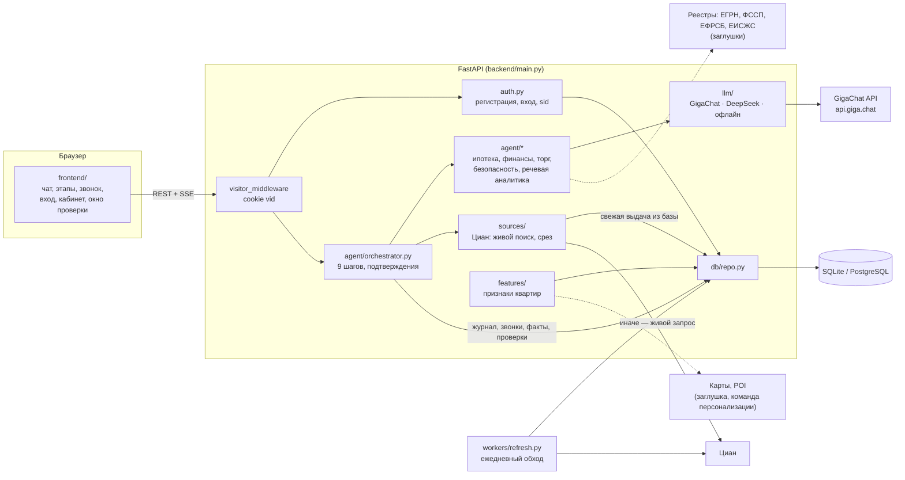

# Архитектура

Схема базы — [ERD.md](ERD.md). Системный промпт агента — [AGENT_PROMPT.md](AGENT_PROMPT.md).

## Слои

| Слой | Где | Что делает | Статус |
| --- | --- | --- | --- |
| Интерфейс | `frontend/` | чат, 9 этапов, звонок, кабинет, окно проверки безопасности | готово |
| HTTP | `backend/main.py` | REST + SSE, раздача фронтенда | готово |
| Пользователи | `backend/auth.py` | cookie посетителя, регистрация и вход по почте, роли | готово; Сбер ID — заглушка |
| Агент | `backend/agent/` | конвейер, ипотека, финплан, торг, проверка, речевая аналитика | готово |
| LLM | `backend/llm/` | GigaChat (`api.giga.chat`), DeepSeek, офлайн-правила | готово; ключ GigaChat — в `.env` |
| Объявления | `backend/sources/` | Циан: живой поиск → база → срез | готово; другие площадки — модулем в `REGISTRY` |
| Признаки | `backend/features/` | `cian` из объявления; `maps`, `registry` | `cian` готов; остальные — заглушки |
| База | `backend/db/` | модели, запросы, справочники | готово |
| Обход | `backend/workers/` | ежедневное обновление, фото на диск | готово; проверка страницы объявления — заглушка |
| Реестры | — | ЕГРН, ФССП, ЕФРСБ, ЕИСЖС, реестр доверенностей | заглушки: статус «не проверено» + ссылки «проверить самому» |
| Телефония | — | реальный звонок голосом | заглушка: продавец-симулятор или человек в чате |

## Поток одной сессии

1. Браузер получает cookie `vid` с первым запросом; посетитель пишется в `visitors`.
2. `POST /api/session` создаёт `agent_sessions` (на посетителя и, если вошёл, на пользователя).
3. Конвейер пишет в `events` всё, что решает клиент: рамки, ответы, отметки, сообщения, открытые продукты.
4. Поиск: `sources.collect` → свежая выдача из базы или живой Циан → `listings` (+ фото, история цены, признаки).
5. Проверка: `security.dossier` → `security_checks`; в интерфейсе каждый пункт открывает окно с методом, доказательствами и ссылкой на официальный сервис.
6. Звонок: `negotiation.run` → расшифровка → `call_analytics.analyze` → `calls`, `call_facts`, `listing_features (seller_call)`.
7. Сделка: `deals` (заглушка статусов).
8. Регистрация или вход: `claim_visitor` переносит всю анонимную историю в аккаунт.

## Безопасность

- Пароли — scrypt (n=2¹⁴, r=8, p=1) с солью; в базе нет паролей в открытом виде.
- Сессии — случайный токен в HttpOnly-cookie `sid`, в базе только SHA-256; выход отзывает сессию.
- 5 неудачных входов на почту за 10 минут — пауза (429).
- Cookie: HttpOnly, SameSite=Lax; `COOKIE_SECURE=true` за HTTPS.
- Админ-эндпоинты (`/api/admin/*`) — только для почт из `ADMIN_EMAILS`.
- Ключи LLM и `DATABASE_URL` — только в `.env` (в git не попадает).
- Персональные данные продавцов не храним.

## Для команды персонализации

Новый признак:

1. Строка в `FEATURES` модуля в `backend/features/` (например `maps.py`): ключ, название, тип, единица, группа, источник.
2. `compute(listing) -> list[Value]` — значения с `source`, `confidence`, `evidence`.
3. Каталог обновляется при старте; значения пишутся в `listing_features` при сохранении квартиры (`repo.upsert_listings` → `_features`).

Чтобы использовать признак в подборе — `agent/tools.score_listing` и `agent/preferences.adjust` (отметки клиента уже в `user_listing_marks`, его запросы — в `agent_sessions.profile`).

## API

| Метод | Путь | Что делает |
| --- | --- | --- |
| POST | `/api/auth/register` `{email, password, name}` | регистрация + вход; анонимная история переходит в аккаунт |
| POST | `/api/auth/login` `{email, password}` | вход |
| POST | `/api/auth/logout` | выход |
| GET | `/api/auth/sberid` | заглушка Сбер ID (501) |
| GET | `/api/me` | пользователь (если вошёл), id посетителя, согласие на cookie |
| GET | `/api/me/history` | поиски, отметки, звонки, число событий |
| POST | `/api/consent` | посетитель закрыл баннер о cookie |
| GET | `/api/listing/{id}/security?sid=` | досье безопасности: критерии с методом, доказательствами, «проверить самому»; факты из звонков с уверенностью |
| GET | `/api/admin/stats` | (admin) объявления, пользователи, события, последние обходы |
| POST | `/api/admin/refresh` | (admin) запустить обход объявлений сейчас |

Остальные эндпоинты сессии агента — в [README](../README.md#api).
