# База данных: ERD

SQLAlchemy 2.0, модели — [`backend/db/models.py`](../backend/db/models.py), запросы — [`backend/db/repo.py`](../backend/db/repo.py).
По умолчанию SQLite (`backend/data/app.db`, создаётся при старте), для прода — PostgreSQL через `DATABASE_URL`.
Таблицы создаются автоматически; миграции для прода — Alembic поверх тех же моделей.

Пометка **заглушка** — таблица или поле уже в схеме, но заполняется частично или будет заполняться модулем, которого пока нет.

```mermaid
erDiagram
    users ||--o{ visitors : "браузеры пользователя"
    users ||--o{ auth_sessions : "входы"
    users ||--o{ agent_sessions : ""
    users ||--o{ events : ""
    users ||--o{ finance_profiles : ""
    visitors ||--o{ events : "журнал до и после входа"
    visitors ||--o{ agent_sessions : ""
    visitors ||--o{ user_listing_marks : ""
    agent_sessions ||--o{ events : ""
    agent_sessions ||--o{ chat_events : "лента диалога"
    agent_sessions ||--o{ calls : ""
    agent_sessions ||--o{ deals : ""

    developers ||--o{ complexes : ""
    complexes ||--o{ listings : "новостройки"
    listings ||--o{ listing_photos : ""
    listings ||--o{ listing_price_history : ""
    listings ||--o{ listing_features : ""
    features ||--o{ listing_features : "каталог признаков"
    listings ||--o{ user_listing_marks : ""
    listings ||--o{ calls : ""
    calls ||--o{ call_facts : "речевая аналитика"
    call_facts |o--o{ listing_features : "факт продавца как признак"
    listings ||--o{ security_checks : ""
    listings ||--o{ deals : ""
    tracked_searches }o..o{ listings : "город, комнаты, тип, бюджет"
    crawl_runs }o..o{ tracked_searches : "ежедневный обход"

    users {
        int id PK
        string email UK
        string password_hash "scrypt, соль на пользователя"
        string name
        string role "user | admin"
        string sber_id UK "заглушка: Сбер ID"
        datetime created_at
        datetime last_login_at
    }
    visitors {
        string id PK "uuid из cookie vid"
        int user_id FK "после входа"
        datetime first_seen_at
        datetime last_seen_at
        string user_agent
        datetime consent_at "закрыл баннер о cookie"
    }
    auth_sessions {
        string token_hash PK "SHA-256 токена из cookie sid"
        int user_id FK
        string visitor_id FK
        datetime expires_at
        datetime revoked_at
    }
    agent_sessions {
        string id PK
        string visitor_id FK
        int user_id FK
        text query
        json profile "город, комнаты, бюджет, семья, оплата"
        string status "running | completed | cancelled | ..."
        string llm_provider
        json result
        string title "название в списке диалогов"
        datetime updated_at "последнее событие"
    }
    chat_events {
        int id PK
        string agent_session_id FK
        int seq "номер события в диалоге"
        string type "message, confirm, resolved, result, step, turn, done, idle, ..."
        json payload "событие целиком, как его видел клиент"
        datetime created_at
    }
    events {
        int id PK
        string visitor_id FK
        int user_id FK
        string agent_session_id FK
        string type "session_started, confirm, client_message, search, login, ..."
        json payload
        datetime created_at
    }
    finance_profiles {
        int id PK
        int user_id FK
        string visitor_id FK
        int monthly_income
        int savings
        int children
        int matcap
        string payment
        string source "client_input | sber_online (заглушка)"
    }
    listings {
        string id PK "cian-335167546"
        string source
        string external_id
        string status "active | removed"
        string city
        string district
        string address
        float lat
        float lng
        int rooms
        float area
        float kitchen
        int floor
        int floors
        int year
        int price "текущая"
        bool is_new
        int complex_id FK
        datetime published_at "на площадке"
        datetime first_seen_at "у нас"
        datetime last_seen_at "последний обход"
        datetime updated_at "менялись данные"
        datetime removed_at
        int miss_count "обходов без объявления подряд"
        datetime page_checked_at "проверка страницы"
        bool page_alive "активно / снято / не удалось"
        json data "объявление целиком"
    }
    listing_photos {
        int id PK
        string listing_id FK
        string url
        int position
        string storage_path "копия на диске (STORE_PHOTOS)"
        string sha256
    }
    listing_price_history {
        int id PK
        string listing_id FK
        int price
        datetime observed_at
    }
    features {
        string key PK "school_distance_m"
        string title
        string kind "num | text | bool"
        string unit
        string group
        string provider "cian | maps | registry | seller_call | model"
        bool implemented "false — заглушка"
    }
    listing_features {
        int id PK
        string listing_id FK
        string feature_key FK
        float value_num
        text value_text
        bool value_bool
        string source
        float confidence "0..1"
        text evidence
        int call_fact_id FK
        datetime observed_at
    }
    developers {
        int id PK
        string name UK
        string inn "заглушка: ЕГРЮЛ"
        int houses_delivered "заглушка"
        int delays "заглушка"
    }
    complexes {
        int id PK
        string city
        string name
        int developer_id FK
        string deadline
        bool finished
        string nashdom_id "заглушка: ЕИСЖС"
    }
    tracked_searches {
        int id PK
        string source
        string city
        int rooms
        bool is_new
        string okrug
        int budget_max
        int requested_count
        datetime last_crawled_at
    }
    crawl_runs {
        int id PK
        string trigger "daily | manual"
        string status "ok | partial | failed"
        int seen
        int added
        int updated
        int price_changed
        int removed
        json errors
    }
    user_listing_marks {
        int id PK
        string visitor_id FK
        int user_id FK
        string listing_id FK
        string mark "like | dislike | shown"
    }
    calls {
        int id PK
        string agent_session_id FK
        string listing_id FK
        string mode "auto | human | voice (заглушка)"
        string seller_role "без имени и телефона"
        json transcript
        string status "agreed | no_deal"
        int asking_price
        int agreed_price
        string viewing_slot
        json analytics
    }
    call_facts {
        int id PK
        int call_id FK
        string listing_id FK
        string key
        string label
        text value
        text quote "слова продавца"
        float confidence "0..1, никогда 1"
        string level "high | medium | low"
        bool hedged
        bool contradicts_listing
        bool changed_during_call
        json reasons
        string verify_with
        string verified_status "unverified | confirmed | refuted"
    }
    security_checks {
        int id PK
        string listing_id FK
        string check_key
        string status "ok | info | warn | partial | not_checked | done"
        text method
        string source
        string source_url
        json evidence
        datetime checked_at
        datetime expires_at
    }
    deals {
        int id PK
        string agent_session_id FK
        string listing_id FK
        string status "draft | signed | registered (заглушка)"
        int base_price
        int final_price
        json plan
    }
```

## Ключевые решения

**Объявление — одна строка `listings` + полная копия в `data`.** Колонки — для поиска и фильтров (город, комнаты, цена, статус), `data` — объявление в формате агента без потерь. Новое поле площадки не требует миграции: оно сразу есть в `data`, колонку добавляем, когда по нему нужно искать.

**Признаки — «квартира → признак → значение» (`listing_features`).** Команда персонализации добавляет признак строкой в каталог `features` и модулем в `backend/features/` — без изменения схемы. У каждого значения есть источник и уверенность: «до школы 400 м» по картам и «кухня 9 м²» со слов продавца живут рядом и не путаются.

**Слова продавца — не документ.** `call_facts` хранит цитату, уверенность и причины; лучший факт по ключу дублируется в `listing_features` с `source = seller_call`. Подтверждение документом (ЕГРН, просмотр) переводит `verified_status` в `confirmed` или `refuted` — заглушка до подключения реестров.

**Анонимный посетитель — полноценный участник.** Всё, что делает человек до регистрации, пишется на `visitor_id` из cookie. При входе `repo.claim_visitor` проставляет `user_id` во всех таблицах с `visitor_id` (events, agent_sessions, marks, calls, finance_profiles, deals).

**Персональные данные.** В базе нет телефонов, имён и паспортов продавцов (в `calls` — только роль). Пароль — хеш scrypt, сессии — хеш токена. Фото — ссылки площадки, копии — по флагу.

## Правило обновления объявлений

1. Поиск клиента сначала смотрит в базу: если этот поиск (`tracked_searches`: город, комнаты, вторичка/новостройки, округ) обходили меньше `LISTINGS_FRESH_HOURS` (24 ч) назад с бюджетом не меньше нужного — выдача берётся из базы, на Циан не ходим.
2. Иначе — живой запрос к Циану; результат сохраняется (`upsert_listings`), поиск ставится в ежедневный обход.
3. Ежедневно в `REFRESH_AT` (или отдельным процессом `python -m backend.workers.refresh --daily 04:00`) воркер обходит все `tracked_searches` до `REFRESH_PAGES` страниц:
   - новое объявление — `added`; изменилась цена — строка в `listing_price_history`; изменились данные — `updated_at`;
   - объявления нет в **полном** обходе — агент открывает его страницу: снято — `removed` сразу; страница жива (просто ушло ниже в выдаче) — остаётся; открыть не удалось — `miss_count + 1`, после `REMOVE_AFTER_MISSES` (2) подряд — `removed`;
   - обход неполный (капча, сеть, страниц больше лимита) — пропуски не считаются;
   - снятое объявление снова появилось — `active`.
4. Каждый обход — строка в `crawl_runs` (что нашли, что сняли, ошибки). Администратор видит её в `/api/admin/stats`.

## Проверка перед показом клиенту

Каждую карточку подборки и каждый объект перед звонком агент проверяет по странице объявления (`cian.check_listing_page`):
404/410, редирект со страницы, плашка «Объявление снято с публикации» или статус снятого в данных страницы — снято;
объявление опубликовано — активно; капча или сеть — «не удалось проверить».

- Снятые убираются из подборки, вместо них добираются следующие по рейтингу; в базе — `status = removed`.
- На карточке — «✓ Объявление активно · проверено в 22:50» или «не удалось проверить» (такие показываем, а не прячем).
- Результат хранится в `listings.page_checked_at / page_alive / page_note`; повторная проверка — не раньше чем через `LISTING_CHECK_TTL_MIN` (30 мин), перед звонком — не старше 10 минут.
- Проверка подборки ждёт не больше `LISTING_CHECK_BUDGET_S` (25 с); запросы к страницам — не чаще раза в секунду.
